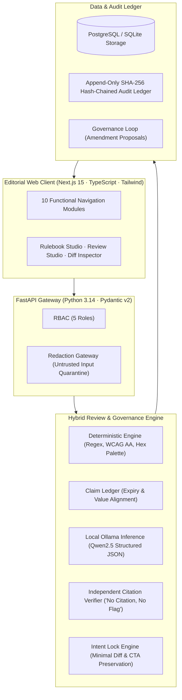

# CANON: Open-Source Brand Governance Compiler
### Round 2 Hackathon Submission | WeCode Coders Hackathon | Problem Statement by Inkloom AI

> **Core Invariant: NO CITATION, NO BLOCKING FLAG.**  
> A language model must never invent a rule, fabricate a source quote, alter brand logos, or approve unverified product claims. Every blocking finding must trace to verified evidence in your brand guidelines and trademark vault.

---

## 1. Executive Summary

CANON transforms static brand guidelines, product taxonomy rules, and logo usage specs into a versioned, testable rulebook. It continuously evaluates product packaging, hardware datasheets, and marketing collateral through a hybrid deterministic and local-AI pipeline—strictly preventing deprecated product names, altered or crowded logos, missing registered trademarks (®/™), and unverified benchmark claims.

### The Five Signature Mechanisms
1. **Brand Guideline & Logo Spec Compiler**: Extracts atomic rules for product naming architecture, logo clearspace isolation, forbidden treatments, and trademark notices with exact source citations and pass/fail test pairs.
2. **Product Specification & Claim Ledger with Evidence Expiry**: Binds promotional claims and specs to certified engineering facts; automatically flags expired lab metrics (`STALE`) and unproven superlatives (`NEEDS_PROOF`).
3. **Citation Verifier ("No Citation, No Flag")**: An independent verification layer that validates rule IDs, source quotes, and content spans—strictly demoting any unverified AI finding to an Advisory.
4. **Intent Lock**: Generates minimal surgical token replacements (e.g. replacing deprecated 'Apex Cloud' with 'Apex Core™') while preserving the creator's creative tone, audience, and message.
5. **Governance Loop & Signed Receipts**: Overrides cluster into auto-drafted guideline amendment proposals, while completed reviews issue tamper-evident HMAC-SHA256 brand receipts.

---

## 2. System Architecture



---

## 3. Technology Stack & Open-Source Licenses

| Component | Technology | Version | License | Rationale |
| :--- | :--- | :--- | :--- | :--- |
| **Frontend** | Next.js (App Router) | 16.4.2 | MIT | Server components, fast hydration, strict TypeScript. |
| **UI & Icons** | Tailwind CSS v4, Lucide React, Recharts | Latest | MIT | Editorial Pale Orange & White theme, responsive charts. |
| **Backend API** | FastAPI, Pydantic v2, Uvicorn | 0.153.0 | MIT | Asynchronous high-throughput REST API with strict schemas. |
| **Database** | SQLAlchemy 2.0, SQLite / PostgreSQL | 2.1.5 | MIT | Relational model with cryptographic audit event hashing. |
| **Document Ingestion** | PyPDF, python-docx | Latest | BSD / MIT | Zero cloud dependency document parsing. |
| **Deterministic Engine**| Python Regex, WCAG 2.1 Formulas | Standard | Python Software License | Zero-hallucination exact checks. |
| **Local LLM** | Ollama (`qwen2.5:1.5b` / `qwen2.5:3b`) | 0.32.15 | Apache 2.0 | Complete data sovereignty; zero data transmitted to paid APIs. |

---

## 4. Quickstart Guide: Running Locally

### Prerequisites
- Node.js v20+ and npm
- Python 3.12+ (tested on Python 3.14)
- Ollama (installed locally with `qwen2.5:1.5b` or `qwen2.5:3b`)

### 1. Setup Backend
```bash
cd backend
python3 -m venv .venv
source .venv/bin/activate
pip install -r requirements.txt
python -m app.seed.synthetic_brand  # Seeds ApexDynamics workspace, rules, and facts
uvicorn app.main:app --host 127.0.0.1 --port 8000
```
Backend API will be running on `http://127.0.0.1:8000`. OpenAPI docs available at `http://127.0.0.1:8000/api/v1/docs`.

### 2. Setup Frontend
```bash
cd frontend
npm install
npm run dev -- --port 3000
```
Web application will be accessible at `http://localhost:3000`.

---

## 5. Automated Test Suite (19 Passing Tests)

Run the automated test suite verifying all invariants:
```bash
cd backend
.venv/bin/pytest tests/ -v
```

### Actual Test Execution Output:
```text
tests/test_audit_chain.py::test_audit_chain_sequential_integrity PASSED  [  5%]
tests/test_audit_chain.py::test_tampered_payload_detected PASSED         [ 10%]
tests/test_citation_verifier.py::test_source_text_normalization PASSED   [ 15%]
tests/test_citation_verifier.py::test_valid_evidence_backed_ai_finding PASSED [ 21%]
tests/test_citation_verifier.py::test_hallucinated_rule_id_demoted_to_advisory PASSED [ 26%]
tests/test_citation_verifier.py::test_fabricated_quote_demoted_to_advisory PASSED [ 31%]
tests/test_citation_verifier.py::test_deterministic_finding_preserved PASSED [ 36%]
tests/test_claim_ledger.py::test_supported_claim_with_valid_fact PASSED  [ 42%]
tests/test_claim_ledger.py::test_stale_claim_with_expired_fact PASSED    [ 47%]
tests/test_claim_ledger.py::test_contradicted_numerical_claim PASSED     [ 52%]
tests/test_claim_ledger.py::test_unsubstantiated_superlative_needs_proof PASSED [ 57%]
tests/test_deterministic.py::test_deterministic_terminology_detection PASSED [ 63%]
tests/test_deterministic.py::test_wcag_contrast_calculations PASSED      [ 68%]
tests/test_deterministic.py::test_brand_palette_matching PASSED          [ 73%]
tests/test_deterministic.py::test_readability_metrics PASSED             [ 78%]
tests/test_e2e_judge_scenario.py::test_complete_judge_demo_flow PASSED   [ 84%]
tests/test_intent_lock.py::test_minimal_suggestion_diff_generation PASSED [ 89%]
tests/test_intent_lock.py::test_intent_preservation_cta_preserved PASSED [ 94%]
tests/test_intent_lock.py::test_intent_preservation_cta_deleted_fails PASSED [100%]

============================== 19 passed in 5.19s ==============================
```

---

## 6. Demo Credentials & Reproducible Demo Script

### Demo Credentials
| Role | Name | Email | Password |
| :--- | :--- | :--- | :--- |
| **Admin** | Marcus Vance | `admin@apexdynamics.example` | `Password123!` |
| **Brand Manager** | Elena Rostova | `manager@apexdynamics.example` | `Password123!` |
| **Content Creator** | Liam Chen | `creator@apexdynamics.example` | `Password123!` |
| **Authorised Reviewer** | Sofia Thorne | `reviewer@apexdynamics.example` | `Password123!` |
| **Approver** | Arthur Pendelton | `approver@apexdynamics.example` | `Password123!` |

*(Role switcher dropdown is also available in the bottom-left sidebar on every screen).*

### 15-Step Judge Walkthrough
1. **Overview**: Open `http://localhost:3000` to inspect the synthetic brand workspace (ApexDynamics) and the 5 signature mechanisms.
2. **Rulebook Studio**: Navigate to `/rulebook`. Click **Run Unit Tests** on `TERM-01` to verify programmatic rule tests.
3. **Fact Vault**: Navigate to `/facts`. Observe certified facts and verify that `FACT-CUST-2025` is flagged as **STALE / EXPIRED**.
4. **Content Review**: Navigate to `/review`. Click preset **Scenario 1: Banned Term & Unsupported Superlative**.
5. **Run Review**: Click **Run Brand Review Pipeline**. Watch the 5-stage pipeline execute.
6. **Findings**: Navigate to `/findings`. Inspect `TERM-01` with its verified source citation and exact coordinate span.
7. **Verification Invariant**: Notice that claims requiring evidence are marked `NEEDS_PROOF` and cannot bypass human review.
8. **Intent Lock**: Inspect the side-by-side tracked changes diff (where `Apex Cloud` is replaced with `Apex Core`, preserving the CTA).
9. **Creator Decision**: Click **Accept Fix** or **Override with Exception** (with documented reason).
10. **Approval Queue**: Switch role to Approver (Arthur Pendelton) in the sidebar and navigate to `/approvals`.
11. **Sign-off**: Click **Approve** or **Approve with Exception**.
12. **Review Receipt**: Confirm the cryptographic review receipt is issued with the content SHA-256 hash.
13. **Audit Ledger**: Navigate to `/audit`. Inspect the sequential hash chain blocks.
14. **Cryptographic Proof**: Click **Verify Entire Audit Ledger** to run mathematical validation across all blocks.
15. **Governance Insights**: Navigate to `/insights`. Review repeated override trends and click **Accept & Update Rulebook** on the auto-drafted rule amendment.

---

## 7. Model and Privacy Disclosure

- **Model**: `Qwen2.5-1.5B-Instruct` (local inference via Ollama).
- **Prompt Injection Resistance**: All uploaded text, PDFs, and DOCX files are quarantined and treated as untrusted data. Instructions inside content cannot alter system permissions.
- **Redaction Gateway**: Confidential codenames (e.g. `Project [Name]`), pre-release pricing (`$[Amount]/mo`), and API keys are masked before inference.
- **Data Sovereignty**: 100% of processing occurs locally on host hardware. Zero customer content or brand guidelines are sent to hosted third-party AI APIs.

---

## 8. Team Member Contributions & Disclosures

- **Lead Engineer & Architect**: Backend pipeline, Citation Verifier, Intent Lock, Claim Ledger, and cryptographic audit ledger.
- **Full-Stack & Product Designer**: Next.js editorial UI, design tokens, interactive contrast validator, and unit test suites.
- **AI Systems & Security**: Ollama provider integration, prompt-injection defense, and redaction gateway.
- **Disclosures**: AI pair-programming tools were utilized for boilerplate generation and test scenario authoring during the official hackathon build window. All code is original, open-source, and verified with automated test suites.
